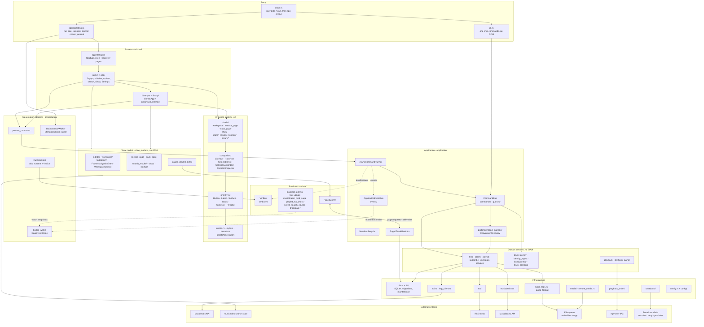
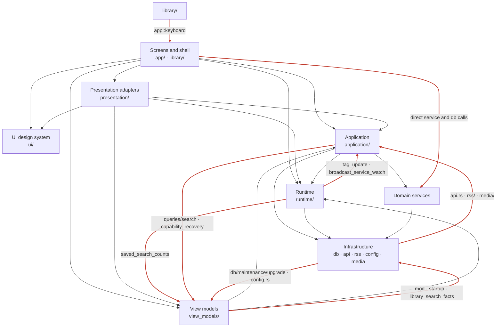
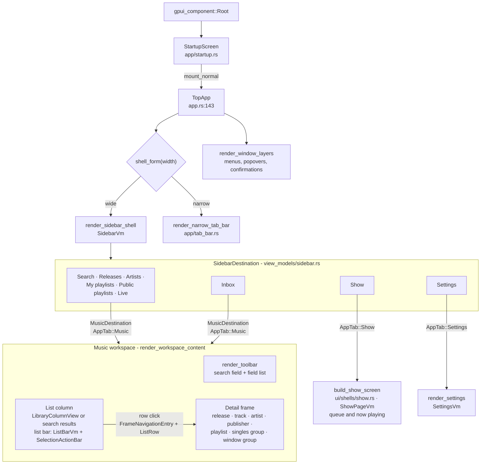
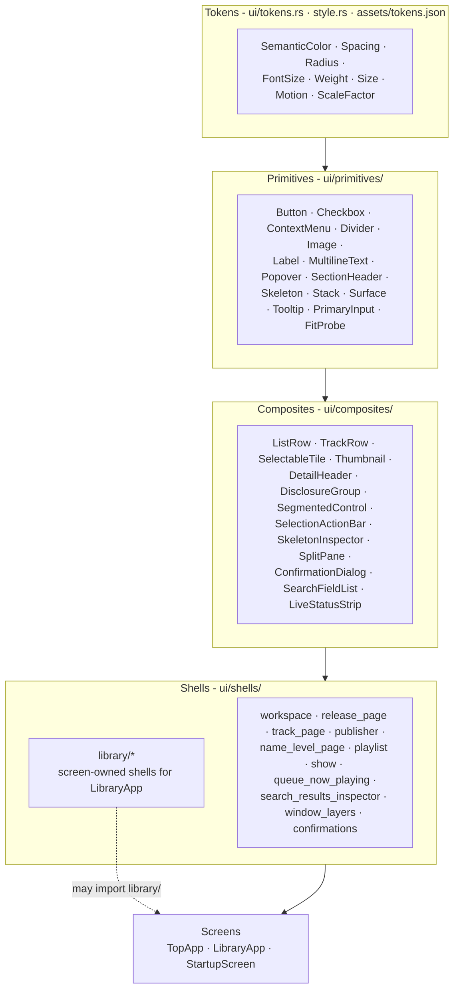
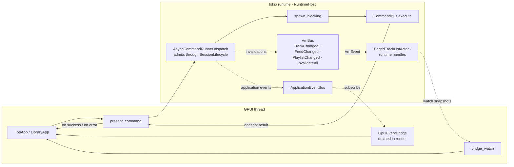
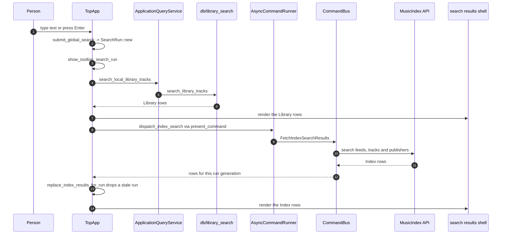
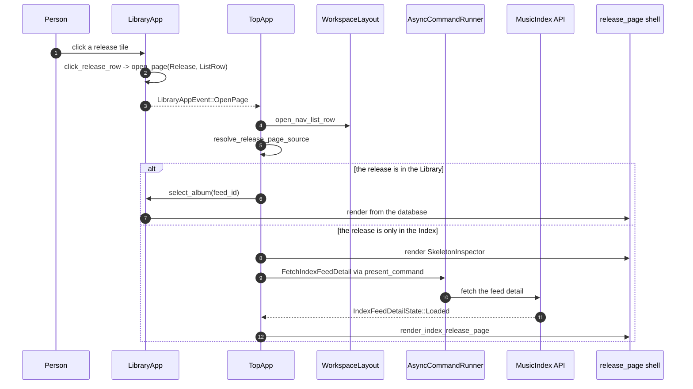
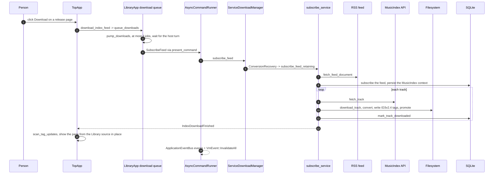
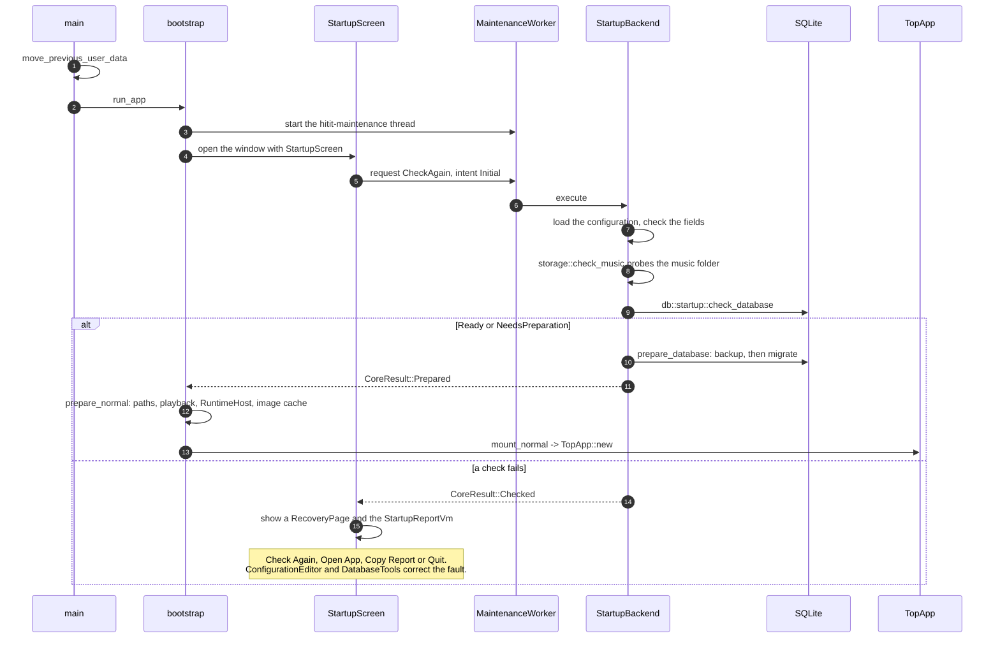

# HitIt Architecture - Current Snapshot

## Status

Current - 2026-11-14, from commit `86d97e7`. This snapshot is advisory. It states no rule.
The layer rules are in ADRs 0023, 0024 and 0042, and `tests/architecture_tests.rs` enforces part of them.
The shell is ADR 0089, the list bar is ADR 0090 and the fit check is ADR 0097.

A subagent surveyed the code at `86d97e7`. The primary session examined the important claims against the code.
When the code and this snapshot disagree, the code is correct. Update this snapshot in the same change as a
change of layer, shell or async model.

`architecture-diagrams.md` is the view of 2026-04-30. Older ADRs cite its "ideal" section. Do not use it as a
description of the current code.

> **Conventions**
> - A solid arrow is a direct call or an import.
> - A dashed arrow is an asynchronous event or a snapshot that a bridge delivers.
> - A module name is its path under `src/`.

---

## 1. System Overview

Important points:

- `main.rs` first moves the user data of v4vmm (ADR 0096 Decision 6). With no argument it starts the app. With an
  argument it runs the CLI, which uses `CommandBus` and no GPUI.
- The app opens on `StartupScreen`. `TopApp` mounts only after the configuration, the music folder and the
  database pass their checks (section 7).
- `TopApp` is the one root entity. `LibraryApp` is a column model in it, not a different tab. There is no
  `SearchApp` and no Discover screen.
- A screen sends a command through `present_command`. The command runs on a blocking thread of the tokio
  runtime, and the result returns to the GPUI thread.

---

## 2. Layer Order And The Edges That Go Against It

The layer order runs from the top to the bottom of this diagram. The red edges go against the order. They are
in the code at `86d97e7`.

At `86d97e7`, `tests/architecture_tests.rs` enforces these rules:

| Test | Rule |
|---|---|
| `view_models_do_not_import_gpui_or_screen_layers` | No GPUI, `ui`, `app` or `library` import in `view_models/` |
| `application_layer_does_not_import_gpui_or_screen_layers` | No GPUI or screen import in `application/` |
| `runtime_layer_does_not_import_gpui_or_ui` | No GPUI, `ui` or `presentation` import in `runtime/` |
| `shared_ui_components_do_not_import_backend_or_screen_layers` | Primitives and composites do not import the application, the services, the database or a screen |
| `shared_top_level_ui_shells_do_not_import_screen_modules` | A shared shell does not import a screen |
| `cx_spawn_is_restricted_to_presentation_runtime_and_bootstrap` | Only these modules start GPUI tasks |
| `gpui_command_runner_is_retired`, `async_runtime_feature_flag_is_retired` | The `GpuiCommandRunner` and the `async-runtime` Cargo feature stay removed |

No test forbids the red edges. Inference: the edge from runtime to application and the edge from application to
runtime make a cycle (`application/async_command_runner.rs:36`, `runtime/tag_update.rs:20`). The screens in
`library/` and `app/search_dispatch.rs` call services and the database directly. Inference: this code is from
the time before the command bus.

---

## 3. The Shell

- A page opens over a list. `FrameNavigationEntry` (`view_models/workspace/nav.rs:70`) names each page:
  `Destination`, `SavedSearch`, `PlaylistDetail`, `PublicPlaylist`, `Release`, `Track`, `ArtistName`,
  `PublisherDetail`, `SinglesGroup`, `WindowGroup`, `Search`, `Settings` and `QueueNowPlaying`.
- `NavigationPathStart` tells if a page starts a new path (`NewPath`), stays in the path (`CurrentPath`) or
  opens from a row (`ListRow`).
- A release page has one of two sources. `ReleasePageSource::Library` reads the database.
  `ReleasePageSource::Index` reads MusicIndex. The two sources use one page shell, `ui/shells/release_page.rs`.
- The window is 390 px wide at minimum (`ui/layouts.rs`). `app/fit_check.rs` checks the shell and the list bar
  at 390 px and 940 px (ADR 0097).

---

## 4. The UI Design System

The shells in `ui/shells/library/` belong to the Library screen, and the module docs in `ui/shells/mod.rs`
permit their import of `library/`. A shared shell does not import a screen.

---

## 5. The Async Model

- `RuntimeHost` (`presentation/runtime_host.rs`) owns a multi-thread tokio runtime and the `VmBus`. If its start fails, it is
  not there. Then the capability `BackgroundRuntime` fails, and `AsyncCommandRunner::unavailable` answers each
  command.
- No screen reads `VmEvent`. The actors and the runtime handles read it, and they send snapshots through
  `bridge_watch`.
- `SessionLifecycle` counts the admitted work. A session stops only after all of its work stops.
- The `async-runtime` Cargo feature is gone. tokio is a usual dependency.

---

## 6. Sequence - A Search From The Toolbar

The `musicindex-search` crate parses the text and builds the `kind:` requests, `q` and the sort parameters
(ADR 0091). HitIt filters its Library rows with `host_keeps_row`.

---

## 7. Sequence - Open A Release Page From A List

---

## 8. Sequence - Take A Release Into The Library

If no track downloads, the feed returns to "not subscribed" and the page shows an error.

---

## 9. Sequence - App Start, Database Check And Recovery

`StartupStage` names the step with the fault. "Check" does not prepare the database. "Open" prepares it again only
if the configuration bytes did not change.

---

## File Map

The [source map](source-map.md) gives the owner file of each area. This table gives the folders of each layer.

| Layer | Files |
|---|---|
| Entry | `src/main.rs`, `src/cli.rs`, `src/app/bootstrap.rs` |
| Startup and recovery | `src/startup.rs`, `src/startup/`, `src/app/startup.rs`, `src/presentation/{startup_presenter,maintenance_executor,configuration_editor,database_tools}.rs`, `src/db/startup.rs`, `src/db/maintenance/` |
| Screens and shell | `src/app.rs`, `src/app/`, `src/library.rs`, `src/library/` |
| UI design system | `src/ui/{tokens,style,layouts}.rs`, `src/ui/{primitives,composites,shells}/`, `src/assets/tokens.json` |
| Presentation adapters | `src/presentation/` |
| View models | `src/view_models/` |
| Application | `src/application/`, with `commands/`, `queries/`, `events/`, `errors/` and `ports/` |
| Runtime | `src/runtime/` |
| Domain services | `src/{feed,library,playlist,metadata}_service.rs`, `src/subscribe_service.rs`, `src/subscribe_service/`, `src/{track_compare,track_identity,identity_ingest,local_identity,local_metadata,playback,playback_owner}.rs` |
| Infrastructure | `src/db.rs`, `src/db/`, `src/{api,http_client,remote_media,musicbrainz,audio_tags,config}.rs`, `src/{rss,audio_format,playback_driver,media,broadcast,provider_observation,config}/` |
